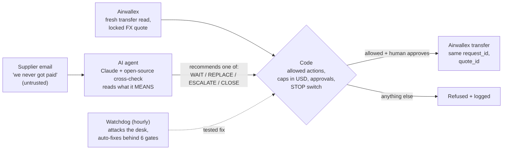

# Agent Allowance: Payment Incident Desk

**Airwallex Agentic Banking Hackathon · Treasury & Ops · Starter Kit 03 (Payment Ops Incident Commander)**
**Builder:** Zach Riehn (Zach's Team)

> **A supplier emails: "we never got paid."** Pay again and you may pay twice; trust the email and it may be a scammer.
> **Agent Allowance** lets an AI agent read the situation and recommend *wait, re-send, escalate or close*, while **code holds the money**: it decides what is allowed, a person approves every payment, and every cap is enforced in code (in USD, even for a EUR invoice paid through a locked Airwallex FX quote).
>
> - **The AI reads what emails mean.** On 16 held-out cases written by a separate AI that never saw our prompt: Claude 16/16, open-source GPT-OSS 15/16, keyword rulebook 9/16 (small test set).
> - **It repairs itself.** Every hour it attacks itself; if a money rule breaks, payments stop until an AI-written fix passes six automatic checks and a person taps Apply.
> - **Try it in 5 seconds, no install:** https://riehnbean.github.io/agent-allowance/demo/ (guided tour, works on a phone; Airwallex is simulated there). **Video:** the 3:50 walkthrough attached to this submission. **Code:** https://github.com/Riehnbean/agent-allowance · run `python3 demo.py` locally (no keys). **Proof:** `receipts/`.

## How this was built
I directed the project. AI coding agents wrote the code, tests and docs. Claude did the main build, and a second AI (OpenAI Codex) reviewed it independently and acted as the attacker. I chose the problem and the safety rules, reviewed the demos and decided what shipped. Every claim in this document can be checked with the tests and scripts in the repo.

## The problem
A supplier emails: *"We never got paid."* An ops person now has to decide fast, and every choice can lose money:
- **Pay again**, and the first transfer may still land, so the supplier is paid twice.
- **Wait**, and the money may have bounced days ago, so a real supplier goes unpaid.
- **Trust the email**, and it may be from a scammer, so the money goes to the wrong account. This is invoice-redirection fraud, the most common business email compromise loss.

An AI agent can help read the situation. But a plain "AI that can send payments" is the wrong design, because one bad prompt or one confused model can lose money.

**Why it matters.** Business email compromise - fake "our bank changed" and "we were never paid" emails - cost US businesses **$3.05 billion in 2025** ([FBI IC3 2025 report](https://www.ic3.gov/AnnualReport/Reports/2025_IC3Report.pdf)), and **63%** of organizations were hit by attempted or actual BEC fraud, with vendor-impersonation fraud up to 45% ([AFP 2025 Payments Fraud Survey](https://www.financialprofessionals.org/about/learn-more/press-releases/Details/survey-79-percent-of-organizations-were-victims-of-attempted-or-actual-payments-fraud-activity-in-2024)).

**Who it's for.** Accounts-payable teams at growing companies (roughly 20-500 people) that pay suppliers through Airwallex, often across currencies, without a fraud team.

**How it differs.** AP platforms and payee-verification tools (Bill.com, Ramp, Trustpair, Eftsure) screen payments *before* they go out: duplicate checks, approval rules, bank-detail verification. Agent Allowance works *after* a payment has gone wrong - failed, partly paid, or disputed by email - using the live Airwallex transfer status to decide whether it is safe to send again, a likely scam, or short-paid. The AI only recommends; code and people hold the money.

## The idea: the AI advises, the code holds the money
Agent Allowance is an incident desk on top of the Airwallex Transfers API. For each incident, the AI agent reads the evidence and recommends one of four actions:

| Action | When |
|---|---|
| **WAIT** | The original transfer could still land. |
| **REPLACE** | Airwallex confirms the original failed for a reason that is safe to retry. |
| **ESCALATE** | Bank details look wrong, fraud signals appear, or anything is unclear. |
| **CLOSE** | The money is confirmed PAID and nothing else is in flight. |

The model never touches money. Code first works out which actions are allowed. The model can only pick from that list, and anything else is rejected and logged. Each money rule below is enforced in code and has a named test; `COVERAGE.md` lists what is tested, what is partial and what is out of scope:

- **Double payment is blocked.** A replacement is blocked while any payment on the incident might still clear. A lost Airwallex reply becomes `UNKNOWN`, the budget stays held, and the desk reconciles using the *same* `request_id`.
- **No early replacement.** REPLACE needs a fresh `GET /transfers/{id}` at the moment of sending, showing the original CANCELLED for a retry-safe reason.
- **Redirected payments are blocked.** The agent has no tool that changes a beneficiary. Supplier text is labelled *untrusted*, and bank-change wording the filter recognises forces ESCALATE (best effort; the money still only goes to the verified account). A payee edited inside Airwallex is caught by a details hash, and the desk stops.
- **Caps hold.** Per-payment, per-payee and daily caps count reserved and uncertain payments, including possible fees. Writes are serialized with SQLite `BEGIN IMMEDIATE`.
- **People stay in charge.** Each approval is bound to payee, amount, currency, bank details and expiry, and can be used once. Large or split payments need a second named person. A STOP switch halts everything, and a system STOP needs two people to clear.
- **Webhook claims are not applied.** A webhook only triggers a fresh read from Airwallex. Its claimed status is logged and never applied.

Every step goes into an append-only, hash-chained evidence log. Each incident exports a receipt that labels every line by source: *observed* (read back from Airwallex), *decided* (code), *model* (AI opinion), *operator* (a person) or *untrusted* (supplier text).

## Two AIs and a rulebook
The demo desk runs this chain:
1. **Claude** (Sonnet 5.5, using the hackathon's Claude API credits) recommends an action.
2. **A second, open-source AI checks it.** That's GPT-OSS 20B through a free hosted endpoint, or Qwen2.5-3B running on the machine. If the two AIs disagree, the desk takes the most careful allowed choice (ESCALATE, then WAIT, then CLOSE, then REPLACE) and shows both answers.
3. If no AI answers, a deterministic rulebook does.

**Why an AI and not just rules:** the rulebook handles the clear cases and the code enforces the money limits either way. What rules cannot do is read meaning. On the 16 held-out cases the keyword rulebook got 9 right and Claude 16. In our earlier, builder-written 13-case set, a payment-redirect request with no scam keyword, a "we only received $230" reply, and a fake-CEO "skip the approvals" message all fooled the rulebook; both AIs caught all three and did not over-react to a friendly note (receipts below).

The desk also runs with **no paid API at all**: open-source models only, then the rulebook. That's one setting.

Account numbers, IBANs and emails are stripped from supplier text before *any* model sees it, including the disguises our reviewer tried: spelled out, spaced, dashed, dotted, lower-case, HTML entities, invisible characters, non-Latin digits and base64 (a best-effort text filter, tested in `tests/test_nov1_review.py` and `tests/test_nov1_verify.py`, not a guarantee against every possible encoding). The code limits what the agent may do, so a weaker or tricked model can't create an unsafe action. It can only pick a worse *safe* one, and the operator sees which brain answered. Payments are already protected by code and human approval, so the double check only makes the *advice* safer.

So the operator never waits on the model, the desk asks the AI as soon as an incident changes ("think-ahead"). The model wait is capped at 6 seconds (the two AIs think in parallel, usually 3–4 seconds), and if they are not done, the rulebook answers. The re-read of in-flight payments from Airwallex that happens before the models are asked has its own 30-second network timeout and is not inside that cap.

## Watchdog: it attacks itself and repairs itself

Every hour (`WATCHDOG_EVERY=3600`, or `python3 -m watchdog.cycle` from a scheduler) the desk plays about 2,000 generated attack scenarios against a throwaway copy of itself: broken or contradictory Airwallex replies, disguised bank-change emails (invisible characters, HTML entities, spelled-out or full-width digits, base64), two operators clicking at once, STOP, webhooks and clock jumps. After every step it checks the money rules: no transfer to an unapproved payee or over a cap, nothing sent while stopped, never a second live transfer for one invoice, and no money at Airwallex that the desk does not track.

When a rule breaks, the AI does the repair work; a person only decides when the fix goes live:
1. The scenario is shrunk to the shortest steps that still break it and saved as a permanent regression test.
2. If it is a money rule, the live desk presses its own STOP (it can only ever lift a STOP it pressed itself).
3. A repair model (Claude) writes a fix. Six automatic gates must all pass: the edit stays inside the payment code and removes no refusal, alarm, lock or STOP; no test that passed before fails; this finding and every earlier one replay clean and the open-finding count goes down; 300 fresh attacks show no new kind of break; and a second model reviews the diff and must answer APPROVE.
4. The fix is committed with its gate results and **payments stay paused**. A bar on the desk says what broke and that the fix passed all six gates; a person taps **Apply fix and resume** (the desk restarts on the new code once nothing is mid-send and the STOP lifts) or **Reject fix** (the commits are reverted and payments stay stopped). That is the default (`WATCHDOG_APPLY=approve`) because money systems need a person to sign off code changes; `WATCHDOG_APPLY=auto` runs fully hands-off. If no attempt passes every gate, the desk stays stopped. Failing safe is the default. If the suite ever goes red after a Watchdog fix, the next cycle reverts it.

**Receipt (`receipts/watchdog-selfrepair-demo/`, recorded in the hands-off `auto` mode):** we deliberately removed a real fix (the sweeper re-reading cancelled payments) from a copy of the repo and ran one unattended cycle. In about 15 minutes it ran 1,922 scenarios, found the planted money bug *and* a new scam disguise nobody had tried (HTML entities split by zero-width characters), fixed both on the first attempt with all six gates passing, and committed them (`a9b1414`, `e540c3d`). The scam fix is now in the main build. On its first run against the main build, the Watchdog found two real bugs that three rounds of AI review had missed (`watchdog/findings/UNTRACKED_MONEY-1448168a.json`, `SCAM_NOT_ESCALATED-9bbc944f.json`; both now replay clean as permanent tests).

What it is not: the attacks run against a fake Airwallex, so it finds logic bugs, not provider outages; the money rules it checks are the ones written in `watchdog/sim.py`; and an automatic fix is only as good as the gates, which is why a failed gate leaves the desk stopped rather than guessing.

## Airwallex APIs used (sandbox)
`POST /authentication/login` · `POST /beneficiaries/create` · `GET /beneficiaries/{id}` · `POST /beneficiaries/verify_account` · `POST /fx/quotes/create` · `POST /transfers/create` (with `quote_id`) · `GET /transfers/{id}` · `GET /transfers?request_id=` · `GET /transfers?from_created_at=` · `GET /balances/current` · `POST /simulation/transfers/{id}/transition`

**Paying suppliers abroad (locked FX).** A German supplier invoices EUR 250.00; our balance is USD. Before anything is reserved, the desk locks an Airwallex quote for exactly EUR 250.00 and checks the quote itself: right currency pair and amount, an id, at least a minute of validity, a price that matches its rate, and a markup over the mid-market rate within policy (1.5% by default). Every cap (per payment, per payee, daily, co-sign line) is then checked on the **locked dollar cost**, not the euro face value. The transfer goes out with that `quote_id`; if the quote expires during the pre-send checks, nothing is sent; if Airwallex books more dollars than the locked cost plus the fee limit, the incident is alarmed. Sandbox receipt (`receipts/sandbox-fx-eur.txt`): EUR 250.00 at a locked 1.125853, USD 281.46 booked by Airwallex exactly as quoted, markup 88 bps. Real sandbox transfer ID: `deecb5f1-fe9c-45be-8d21-6e6e5a35f548`. 11 tests in `tests/test_fx.py`, and the Watchdog now attacks FX too (wrong-amount, incomplete, over-markup, short-lived, wrong-pair and under-priced quotes).

Things we checked by probing the sandbox:
- A failed transfer ends `CANCELLED`, and the reason is in `failure.message`.
- `failure.details.type` is always `INCORRECT_ROUTING` in sandbox, so we classify by message. Anything we don't recognize is never auto-retried.
- `SENT` must come before `PAID` or `FAILED`.

## Evidence
- **187 automated offline test runs** (no network; the six live-sandbox scenarios in `scripts/sandbox_e2e.py` are separate and need sandbox keys). They include red-team suites written by an independent AI reviewer (OpenAI Codex): 20 attack tests, 9 holes found on Oct 27, and two more review rounds on Nov 1 (a replacement payment allowed after a failed or empty fresh read, disguised bank details, stale advice, an off-by-one approval expiry, and out-of-order screen updates), plus a separate independent Claude reviewer that had not seen the earlier reviews (a release/re-send race that could leave a sent transfer untracked, a co-sign split across duplicate payee records, a two-person check that re-read the payee after confirmation, and missed plain-English bank-change and "still unpaid" wording). Each was shipped as a failing test and then fixed.
- **`scripts/sandbox_e2e.py`** runs 6 scenarios against the live Airwallex sandbox: normal pay, lost reply, channel-timeout replacement, closed account, payee edited in Airwallex, and same-payee totals needing a co-signer. All 6 pass.
- **The main AI result: a held-out test** (`scripts/heldout_eval.py`, `heldout/cases.json`). 16 cases written by a separate AI agent that never saw the prompt, the code or our own cases: 8 subtle "get a person" emails (a "parent company" payment switch, a different payment platform, a reply-chain spoof, a hidden instruction to the AI) and 8 harmless emails written to trip keyword filters. **Claude 16/16, free GPT-OSS 15/16** (it would have closed an invoice where only part of the money arrived), **keyword rulebook alone 9/16**. It is a small test set, so read it as a direction, not a benchmark. Receipts: `receipts/heldout-16-*.txt`. The AI still cannot move money; code checks every pick, and the live desk falls back to the rulebook if the AI takes more than 6 s.
- **More evals** (`scripts/llm_eval.py`, `receipts/eval-13-*.txt`): 13 builder-written incidents, including judgment cases with no scam keyword ("$230 landed, the invoice was $250", a "CEO" demanding approvals be skipped). Rulebook 10/13; Claude Sonnet 5.5, GPT-OSS and the two cross-checked all 13/13. An older 9-case run with an offline Qwen2.5-3B backup got 7/9 (both misses were the cautious choice).
- **`COVERAGE.md`** maps 128 researched payment failure routes to how the desk handles each: 95 built and tested, 19 partial, 14 out of scope with reasons. Sources include Airwallex docs, Nacha, FBI IC3, idempotency guidance and the OWASP LLM Top 10.

## How it could make money (a plan, not yet tested with customers)
- **Who pays:** the finance or AP team at a company already paying suppliers through Airwallex. The cost of one double payment or one redirected invoice is usually far more than a software subscription.
- **How it would be sold:** as an add-on listed where Airwallex customers already look (Airwallex's partner/app ecosystem), priced per desk seat or per incident handled. No price has been tested yet.
- **Next step:** short interviews with AP teams to learn how many failed or disputed payments they handle a month, and what one costs them.

## Honest scope
- Short payments (the supplier received less than was sent) go to a person on purpose: the desk shows the gap and blocks a full re-send, but does not create a top-up payment by itself.
- Sandbox only. One owner, a home currency of USD, and a small allowlist of suppliers: US LOCAL (ACH) payouts plus EUR payouts through a locked Airwallex FX quote.
- Operator login is a demo token. The evidence log is tamper-*evident* inside the app, not tamper-proof against a database admin.
- It is not production-ready, and it has no customers or revenue.
- What it shows is a pattern: **let an AI agent help with payment incidents while every path that moves money stays in tested code the agent cannot call.**

## Run it
See `README.md`. It needs Python 3.10+ and the standard library only. Sandbox keys go in environment variables and are never committed.
